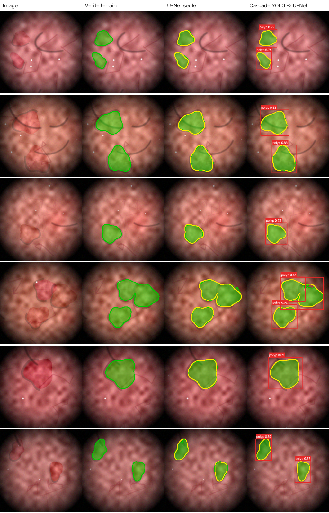
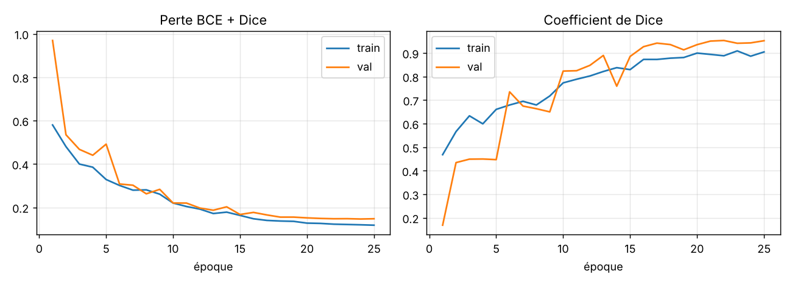

# 🩺 Détection & segmentation de polypes — YOLO + U-Net

Mini-projet d'imagerie médicale : **détecter** les polypes colorectaux sur des images
d'endoscopie avec **YOLOv8**, puis **segmenter** chaque lésion au pixel près avec une **U-Net**
écrite en PyTorch. Les deux modèles sont combinés dans un **pipeline en cascade**.

> ⚠️ Projet pédagogique / portfolio, non validé pour un usage clinique.


<sub>Colonnes : image · vérité terrain · U-Net seule · cascade YOLO → U-Net (boîtes rouges = YOLO,
vert = masque prédit, contour jaune = vérité terrain).</sub>

---

## Pourquoi ce projet ?

Le cancer colorectal se développe le plus souvent à partir de polypes. Les repérer pendant
une coloscopie est essentiel, mais une part des polypes passe inaperçue. L'aide par ordinateur
peut répondre à deux questions complémentaires :

| Question | Tâche | Modèle | Sortie |
|---|---|---|---|
| *Y a-t-il une lésion, et où ?* | Détection | **YOLOv8** | boîtes + score de confiance |
| *Quels sont ses contours exacts ?* | Segmentation | **U-Net** | masque binaire au pixel |

## Architecture

```text
            ┌──────────┐  boîtes   ┌───────────────┐  ROI   ┌────────┐  masque local
 image ───► │  YOLOv8  │ ────────► │ marge + crop  │ ─────► │ U-Net  │ ───────────┐
            └──────────┘           └───────────────┘        └────────┘            │
                                                                                  ▼
                        masque final ◄──── recollage dans l'image (max des probabilités)
```

* **YOLOv8n** (Ultralytics) : détecteur une-étape, rapide (~3 M paramètres).
* **U-Net** (Ronneberger et al., 2015) : encodeur–décodeur à 4 niveaux avec *skip connections*,
  BatchNorm et dropout dans le goulot ([`medseg/unet.py`](medseg/unet.py)).
* **Entraînement « conscient de la cascade »** : la U-Net voit des images entières **et** des
  recadrages autour des lésions avec marge et décalage aléatoires, qui imitent l'imprécision des
  boîtes YOLO ([`medseg/dataset.py`](medseg/dataset.py)). Un seul modèle sert ainsi aux deux modes.
* **Perte** BCE + Dice (le Dice compense le déséquilibre fond / lésion), AdamW, LR cosinus.

Intérêts de la cascade par rapport à une U-Net seule :
1. la U-Net travaille à **plus haute résolution** sur la lésion (utile pour les petits polypes) ;
2. les **faux positifs** de segmentation loin de toute détection sont éliminés ;
3. on obtient une sortie **objet** exploitable : nombre de lésions, confiance, surface.

## Données

* **[Kvasir-SEG](https://datasets.simula.no/kvasir-seg/)** (Jha et al., 2020) : 1 000 images
  d'endoscopie avec masques de polypes annotés par des gastro-entérologues. Découpage 80/10/10.
* **Jeu synthétique** intégré ([`medseg/data.py`](medseg/data.py)) : muqueuse texturée, vaisseaux,
  plis, zones inflammatoires (leurres), reflets spéculaires et vignettage d'endoscope. Il permet
  de tester toute la chaîne en quelques minutes, sans téléchargement.

Les **boîtes YOLO sont calculées à partir des masques** (composantes connexes) : détection et
segmentation décrivent donc exactement les mêmes lésions.

## Résultats

### Kvasir-SEG

À compléter après un entraînement sur GPU (Colab : ~15 min) avec les commandes ci-dessous :
`scripts/evaluate.py` écrit le tableau dans `results/metrics.md`. Ordres de grandeur attendus
dans la littérature : Dice ≈ 0,80–0,90 pour une U-Net, mAP@50 ≈ 0,85–0,95 pour YOLOv8.

### Jeu synthétique (vérification de bout en bout, CPU)

| Détection (YOLO) | mAP@50 | mAP@50-95 | Précision | Rappel |
|---|---|---|---|---|
| boîtes de polypes | 0.958 | 0.592 | 0.880 | 0.886 |

| Segmentation | Dice | IoU | Précision | Rappel |
|---|---|---|---|---|
| U-Net seule (image entière) | 0.938 | 0.898 | 0.949 | 0.945 |
| Cascade YOLO → U-Net | 0.958 | 0.937 | 0.970 | 0.955 |

<sub>600 images (420/90/90) · YOLOv8n entraîné **from scratch**, 40 époques, 320 px · U-Net (1,9 M param., base 16), 25 époques, 192 px · CPU 4 cœurs, ~1 h au total.</sub>

**Lecture :** la cascade améliore le Dice de 0,938 à 0,958 et réduit les faux positifs (précision 0,949 → 0,970).
Le Dice de validation dépasse celui d'entraînement car l'entraînement inclut augmentations et recadrages, plus difficiles.
Cas d'échec visible (ligne 4) : deux polypes accolés produisent des boîtes qui se chevauchent.

Ces chiffres valident le fonctionnement de la chaîne, pas une performance clinique : les
données synthétiques sont bien plus simples que de vraies images d'endoscopie.



## Utilisation

```bash
pip install -r requirements.txt
```

**1. Données**

```bash
python scripts/prepare_data.py --source kvasir
```

Ou, pour un test rapide sans téléchargement :

```bash
python scripts/prepare_data.py --source synthetic --n 600
```

**2. Détection — YOLOv8**

```bash
python scripts/train_yolo.py --model yolov8n.pt --epochs 50 --imgsz 512
```

**3. Segmentation — U-Net**

```bash
python scripts/train_unet.py --epochs 40 --size 256
```

**4. Évaluation : détection, U-Net seule, cascade**

```bash
python scripts/evaluate.py
```

**5. Inférence sur vos images**

```bash
python scripts/infer.py mon_image.jpg
```

**6. Démo web (Gradio)**

```bash
python app.py
```

**Tests**

```bash
pytest -q
```

## Structure

```text
medical-imaging-yolo-unet/
├── medseg/
│   ├── data.py        # Kvasir-SEG, générateur synthétique, masques → boîtes YOLO
│   ├── dataset.py     # Dataset PyTorch (augmentations + recadrages « type YOLO »)
│   ├── unet.py        # architecture U-Net
│   ├── metrics.py     # perte BCE+Dice, Dice / IoU / précision / rappel
│   └── pipeline.py    # cascade YOLO → U-Net + visualisation
├── scripts/           # prepare_data, train_yolo, train_unet, evaluate, infer
├── tests/             # tests unitaires (pytest)
├── app.py             # démo Gradio
└── docs/              # figures du README
```

## Pistes d'amélioration

* Encodeur pré-entraîné (ResNet / EfficientNet) pour la U-Net, ou U-Net++ / Attention U-Net.
* YOLOv8-seg comme référence « un seul modèle » face à la cascade.
* Validation croisée sur CVC-ClinicDB pour mesurer la généralisation à un autre hôpital.
* Export ONNX et inférence temps réel sur flux vidéo.

## Références

* Ronneberger, Fischer, Brox — *U-Net: Convolutional Networks for Biomedical Image Segmentation*, MICCAI 2015.
* Jha et al. — *Kvasir-SEG: A Segmented Polyp Dataset*, MMM 2020.
* Jocher et al. — *Ultralytics YOLOv8*, 2023.
